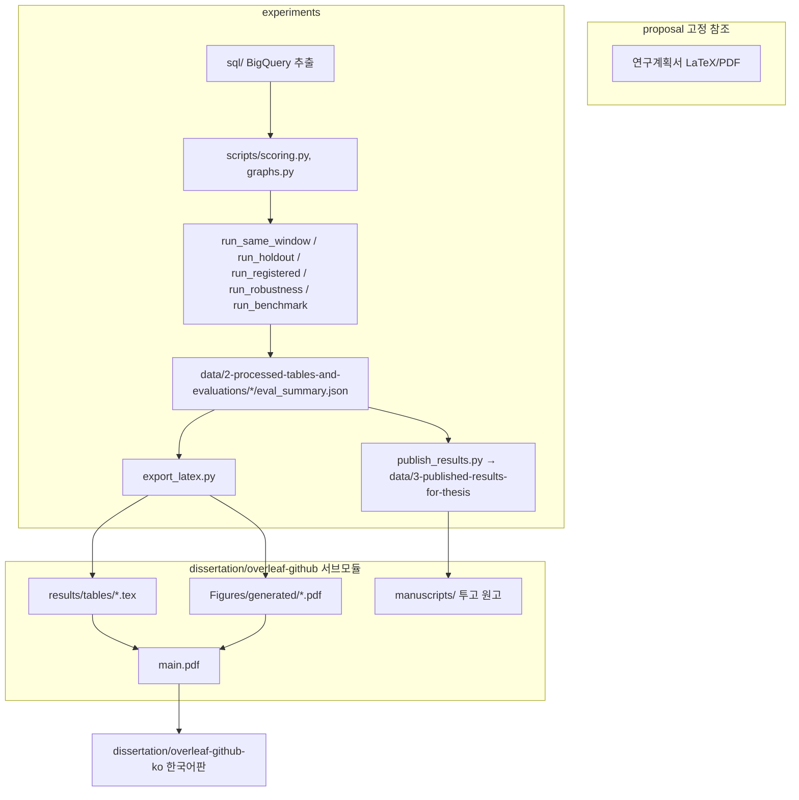

# phd_works — EndorseRank 박사 연구

**EndorseRank**에 관한 박사 연구: Arbitrum One에서 ERC-20 허락(allowance) 간선을 PageRank에 넣어 스마트 컨트랙트의 온체인 평판을 매기고, 송금 간선의 Adaptive Weighted PageRank(AWP), 두 층을 함께 걷는 C-PR, 원시 차수와 비교합니다.

이 저장소에는 **완료된 연구계획서**(고정 참조), **작업 중인 학위논문**(영문 원고 서브모듈과 한국어 번역본), **실험 코드와 데이터**, 공유 참고 논문이 있습니다.

**기여자 및 AI 에이전트를 위한 원칙:** `1-Dissertation-Works/ERC20-Allowance-PageRank-Wallet-Reputation/dissertation/`과 `experiments/`를 편집하고, 연구계획서를 바꾸라는 명시적인 요청이 없는 한 `proposal/`은 읽기 전용 기준선으로 취급합니다. `archive/`는 보관 자료라 고치지 않습니다.

> **2026-10-11 논문 교체:** 2026-10-09에 `1-Dissertation-Works/ERC20-Allowance-PageRank-Contract-Reputation/`에서 시작한 컨트랙트 평판 연구가 지갑 평판 연구를 대신합니다. 그 내용은 `1-Dissertation-Works/ERC20-Allowance-PageRank-Wallet-Reputation/` 아래로 옮겼고(원고는 서브모듈 `phd-dissertation-draft-en`, 실험은 `experiments/`), 지갑 평판 연구 자료는 같은 폴더의 `archive/`에 보관했습니다. 논문 제목은 승인된 연구계획서의 제목 *Integrating ERC-20 Allowance Edges into PageRank for Enhanced On-Chain Wallet Reputation Scoring*을 그대로 씁니다.

---

## 개발 현황

| 단계 | 상태 | 위치 |
|------|------|------|
| 연구계획서 | **완료 · 고정** | `1-Dissertation-Works/ERC20-Allowance-PageRank-Wallet-Reputation/proposal/proposal/` |
| 저장소 재구조화 | 완료 (2026-10-01: 실험 코드를 논문 폴더 안으로; 2026-10-07: 제안서와 논문 작업을 `1-Dissertation-Works/<논문 제목>/` 아래로; 2026-10-11: 컨트랙트 평판 연구로 교체, 지갑 평판 자료는 `archive/`로) | `1-Dissertation-Works/ERC20-Allowance-PageRank-Wallet-Reputation/` |
| 학위논문 원고 (영문) | **활성** | `…/dissertation/overleaf-github/` (서브모듈 `phd-dissertation-draft-en`, Overleaf) |
| 학위논문 한국어 번역본 | **활성** | `…/dissertation/overleaf-github-ko/` |
| 학위논문 발표 자료 (HTML 슬라이드) | **활성** | `…/dissertation/presentation/` |
| 투고 원고 2편 (PLOS ONE, IEEE Access) | **활성** | `…/dissertation/overleaf-github/manuscripts/` |
| 실험 파이프라인 | **완료 (등록 분석 + 수정 분석)** | `…/experiments/` — BigQuery 추출, 점수, 평가, 표 내보내기 |

(`…`는 `1-Dissertation-Works/ERC20-Allowance-PageRank-Wallet-Reputation`)

---

## 연구 요약

- **대상:** Arbitrum One에서 서로 다른 주인 셋 이상에게 WETH·USDC·USDT0·ARB·WBTC 허락을 받은 스마트 컨트랙트 15,107개(수정 분석). 일반 지갑(EOA)은 간선의 출발점과 도착점으로만 들어갑니다.
- **기간:** 관측 2023-10-01 ~ 2026-06-30, 홀드아웃 W0(2026-03-31 동결, 4~6월 라벨), 등록 재현 W1(2026-06-30 동결, 7~9월 라벨).
- **점수:** EndorseRank(허락 간선 PageRank), AWP(송금 간선), C-PR(λ로 두 층을 섞어 걷기), S-PR, 원시 차수.
- **두 분석:** 등록 분석(원시 단위, 모든 토큰; 계획 `43d8045`, W1 등록 `0d3a057`은 추출 전에 커밋)과 수정 분석(USD, 상위 다섯 토큰; 등록 결과를 본 뒤 2026-10-10에 수정 계획을 커밋하고 계산). 논문의 주 결과는 수정 분석이고, 그 결과를 '등록된 결과'라고 부르지 않습니다.
- **주요 결과(원고 초록):** 각 점수는 자기 간선으로 만든 점검과 가장 잘 맞았고(EndorseRank τ = 0.585, AWP τ = 0.572), 두 점수의 순서는 달랐습니다(τ = 0.174). 기간 밖에서 AWP는 송금 입차수보다 새 송금자를 잘 맞혔지만, 균등 재시작 EndorseRank는 허락한 주인 수보다 새 허락 쌍을 덜 맞혔습니다. C-PR(λ = 0.5)은 계획의 규칙 A도, 등록의 규칙 B도 충족하지 못했습니다. 숫자는 모두 `…/experiments/data/3-published-results-for-thesis/revised-usd/results_digest.md`에 근거가 있습니다.

---

## 아키텍처 — 코드와 원고



**핵심 규칙:** 결과 표와 그래프의 수치를 **손으로 고치지 마세요.** `experiments/`에서 `CONTRACT_REP_VARIANT=usd python scripts/export_latex.py`로 다시 만들면 서브모듈 `dissertation/overleaf-github/`의 `results/tables/`와 `Figures/generated/`에 씁니다.

---

## 폴더 구조

최상위 폴더는 `1-Dissertation-Works/`(논문), `2-Graduation/`(졸업 요건·공문), `3-Roundtable/`(진전 발표), `papers/`(참고 논문)입니다. 논문 폴더 아래 `ERC20-Allowance-PageRank-Wallet-Reputation/`은 논문 제목 *Integrating ERC-20 Allowance Edges into PageRank for Enhanced On-Chain Wallet Reputation Scoring*을 줄인 이름입니다(전체 제목을 쓰면 Windows 경로 길이 제한 260자를 넘음). 같은 폴더 아래 `Stacks-PostCondition-PageRank-Clarity-Registry/`는 두 번째 논문 『Stacks 패키지 레지스트리를 위한 Clarity 스마트 컨트랙트 순위 산정: ERC-20 allowance를 대신하는 포스트컨디션』(한국어 원고)의 작업 폴더로, EndorseRank와 AWP를 Stacks Clarity 컨트랙트 레지스트리의 순위에 옮겨 씁니다. 폴더 이름은 영문 제목 *Ranking Clarity Smart Contracts for a Package Registry on Stacks: Post-Conditions in Place of ERC-20 Allowances*를 줄인 것입니다.

| 경로 (`…` = `1-Dissertation-Works/ERC20-Allowance-PageRank-Wallet-Reputation`) | 역할 |
|------|------|
| `…/README.md` | 논문 폴더 안내: 기간, 두 분석, 데이터, 지킬 것 |
| `…/proposal/` | 완료된 연구계획서 (정본 LaTeX: `…/proposal/proposal/`) |
| `…/dissertation/overleaf-github/` | **활성** 영문 원고 (서브모듈 `phd-dissertation-draft-en`, Overleaf가 `main`을 읽음). `manuscripts/`(투고 원고 A·B), `analysis/`(닫힌 꼴 점검, 중립 라벨 비교의 근거 JSON) 포함 |
| `…/dissertation/overleaf-github-ko/` | 영문 원고를 초등학생도 읽을 수 있는 쉬운 한국어로 옮긴 번역본 (`main.pdf`, 번역 기준 `TRANSLATION-GUIDE.md`) |
| `…/dissertation/presentation/` | 학위논문 발표 자료: 한국어 HTML 슬라이드 59장(`index.html`, 오프라인 실행, 3D 데이터 시각화와 수식 유도) |
| `…/dissertation/notes/` | 원고 작성 규칙(`_writing-brief.md`)과 메모 |
| `…/experiments/` | 실험 코드와 데이터: `sql/`, `scripts/`, `tests/`, `config/`, `docs/`(분석 계획·등록·수정 계획), `data/` |
| `…/archive/` | 2026-10-11 이전 지갑 평판 연구 자료 (실험 코드와 데이터, 한국어판, 로컬 원고 자료와 교수님 피드백 원문, 어린이 책·오디오북, 피드백 정리) |
| `1-Dissertation-Works/Stacks-PostCondition-PageRank-Clarity-Registry/` | 두 번째 논문 초안: Clarity 컨트랙트 레지스트리(웹)와 `cpm`(CLI), 포스트컨디션으로 allowance를 대신하는 순위 PC-EndorseRank (한국어 원고 `manuscript/`, 설계 메모 `docs/`, 합성 예제 `scripts/`; 설명은 그 폴더의 `README.md`) |
| `2-Graduation/` | 졸업 요건, 인정 학술지 목록, 공문 (`README.md`) |
| `3-Roundtable/` | Roundtable·진전 발표 (일자별 `pptx` / `html`) |
| `papers/` | 공유 참고 PDF |

### `…/proposal/` 내부

| 경로 | 역할 |
|------|------|
| `…/proposal/proposal/` | 승인된 제안서 LaTeX |
| `…/proposal/sources/professor-feedback/` | 교수 코멘트 DOCX (읽기 전용) |
| `…/proposal/archive/` | DOCX 도구, 스냅샷 |
| `…/proposal/scripts/` | DOCX 병합 유틸리티 |

### `3-Roundtable/` 내부

| 경로 | 역할 |
|------|------|
| `3-Roundtable/YYYY-MM-DD/` | 해당 회차 발표 자료 (`index.html` 및/또는 `.pptx`) |
| `3-Roundtable/README.md` | 일자 폴더 규칙 |

### `…/dissertation/overleaf-github/` 내부

| 경로 | 역할 |
|------|------|
| `01-Intro/`, `Chapter-01-…/index.tex` … `Chapter-08-Appendix/` | 앞부분, 6개 장, 참고문헌, 부록 |
| `results/tables/*.tex` | **생성된** 결과 표 (`export_latex.py` 출력) |
| `Figures/generated/*.pdf` | **생성된** 그래프 (`export_latex.py` 출력) |
| `Config/preamble.tex`, `Config/references.bib` | 머리말(XeLaTeX, Times 계열 글꼴), APA 7 참고문헌(biblatex, biber) |
| `build.ps1` | 전체 원고와 장별 PDF 빌드 |
| `manuscripts/`, `analysis/` | 투고 원고와 그 근거 분석 |

---

## 워크플로

### A. 원고 본문 편집

1. `…/dissertation/notes/_writing-brief.md`의 규칙을 읽습니다.
2. `…/dissertation/overleaf-github/Chapter-*/index.tex`를 편집합니다. 바뀐 문단은 한국어판(`…/dissertation/overleaf-github-ko/`)에서도 `TRANSLATION-GUIDE.md`에 따라 다시 옮깁니다.
3. 빌드: `cd …/dissertation/overleaf-github; .\build.ps1` (또는 Overleaf). 서브모듈에서 커밋·푸시한 뒤 이 저장소에서 서브모듈 포인터를 커밋합니다.

### B. 실험 결과와 표 갱신

`…/experiments/`에서 `CONTRACT_REP_VARIANT=usd python scripts/export_latex.py`로 표와 그래프를 다시 만듭니다. 등록 분석은 `CONTRACT_REP_VARIANT` 없이 실행합니다.

- 결과 요약: `…/experiments/data/2-processed-tables-and-evaluations/` (작업본), `…/experiments/data/3-published-results-for-thesis/` (논문 표의 고정본, `results_digest.md`)
- 테스트: `cd …/experiments; python -m pytest tests`

### C. 데이터 다시 받기 (Google Cloud 필요)

BigQuery 추출은 끝났습니다. 그래프 표를 다시 받으려면 `…/experiments/`에서 `bash scripts/download_graph_tables.sh`(쿼리 비용 없음)를 실행합니다. 자세한 것은 `…/README.md`의 데이터 절을 보세요.

### D. 제안서 변경 (드묾)

교수 피드백과 제안서 편집은 `…/proposal/proposal/`에 유지합니다. 제안서 편집을 `…/dissertation/`에 섞지 마세요.

---

## 데이터 정책

| 항목 | 정책 |
|------|------|
| `…/experiments/data/` | GitHub에 올림. 그래프 표 parquet(6.4 GB)은 올리지 않고 `.json` 기록만 올림. 파일은 모두 90 MB 아래로 나눔 |
| `results/tables/*.tex`, `Figures/generated/*.pdf` | `export_latex.py`로 생성; 손으로 고치지 않음 |
| BigQuery 비용 | `…/experiments/data/bq_ledger.json`에 기록, 전체 상한 USD 50 |
| 커밋 | LaTeX 소스, 스크립트, export된 표, 데이터 — `.venv/`와 100 MB 넘는 파일은 제외 |

---

## AI 에이전트 가이드

### 참조 경로 (원고 편집 전에 읽기)

| 참조 | 경로 |
|------|------|
| 원고 작성 규칙 | `…/dissertation/notes/_writing-brief.md` |
| 분석 계획 · W1 등록 · 수정 계획 | `…/experiments/docs/analysis_plan.md`, `registration_w1.md`, `revision_price_weighting.md` |
| 모든 수치와 출처 | `…/experiments/data/3-published-results-for-thesis/revised-usd/results_digest.md` (수정 분석), `…/results_digest.md` (등록 분석) |
| 정본 제안서 LaTeX | `…/proposal/proposal/` |
| 교수 코멘트 (읽기 전용) | `…/proposal/sources/professor-feedback/dissertation-proposal-commented.docx` |
| 교수님 피드백 정리 (보관) | `…/archive/professor-feedback-summary.md` |
| 공유 PDF | `papers/` |

### 해야 할 것 (DO)

- 결과 **수치**는 실험 파이프라인 재실행(워크플로 B)으로만 바꿉니다.
- 원고 본문은 **영어**로 유지합니다; README는 한국어 가능.
- 수정 분석 결과를 '등록된 결과'라고 부르지 않습니다.
- 커밋 시 저장소 커밋 메시지 스타일을 따릅니다.

### 하지 말 것 (DON'T)

- `results/tables/`나 원고에 표 수치를 기억에 의존해 붙여넣기.
- 원고에서 이전 논문·초안·연구계획서를 언급하기(`_writing-brief.md` 규칙 1).
- `…/proposal/` 재구조화, `…/archive/` 수정이나 삭제(새 실험의 테스트가 `archive/wallet-reputation-experiments/scripts/`를 읽음).
- `export_latex.py` 출력을 손으로 고치기.

---

## 빌드

**제안서 (완료):**

```powershell
cd 1-Dissertation-Works/ERC20-Allowance-PageRank-Wallet-Reputation/proposal/proposal
.\build.ps1
```

출력: `…/proposal/proposal/main.pdf`

Word export (PDF 레이아웃 유지):

```powershell
cd 1-Dissertation-Works/ERC20-Allowance-PageRank-Wallet-Reputation/proposal/proposal
.\build-docx.ps1
```

출력: `…/proposal/proposal/main.docx` (pdf2docx from `main.pdf` — Times New Roman, A4, margins, line breaks, figures)

**학위논문 (활성):**

```powershell
cd 1-Dissertation-Works/ERC20-Allowance-PageRank-Wallet-Reputation/dissertation/overleaf-github
.\build.ps1
# 한국어판
cd ..\overleaf-github-ko
.\build.ps1
```

출력: `…/dissertation/overleaf-github/main.pdf`(장별 PDF 포함), `…/dissertation/overleaf-github-ko/main.pdf`

XeLaTeX와 biber가 필요합니다(영문은 TeX Gyre Termes, 한국어판은 kotex와 나눔 글꼴 또는 Windows의 바탕·맑은 고딕).

---

## 관련 문서

- [`1-Dissertation-Works/ERC20-Allowance-PageRank-Wallet-Reputation/README.md`](1-Dissertation-Works/ERC20-Allowance-PageRank-Wallet-Reputation/README.md) — 논문 폴더, 두 분석, 데이터
- [`1-Dissertation-Works/ERC20-Allowance-PageRank-Wallet-Reputation/archive/README.md`](1-Dissertation-Works/ERC20-Allowance-PageRank-Wallet-Reputation/archive/README.md) — 보관한 지갑 평판 연구 자료
- [`HANDOFF.md`](HANDOFF.md) — 다음 작업 세션을 위한 인계

## Git remote

```
origin  https://github.com/abitocodes/phd_works.git
```
